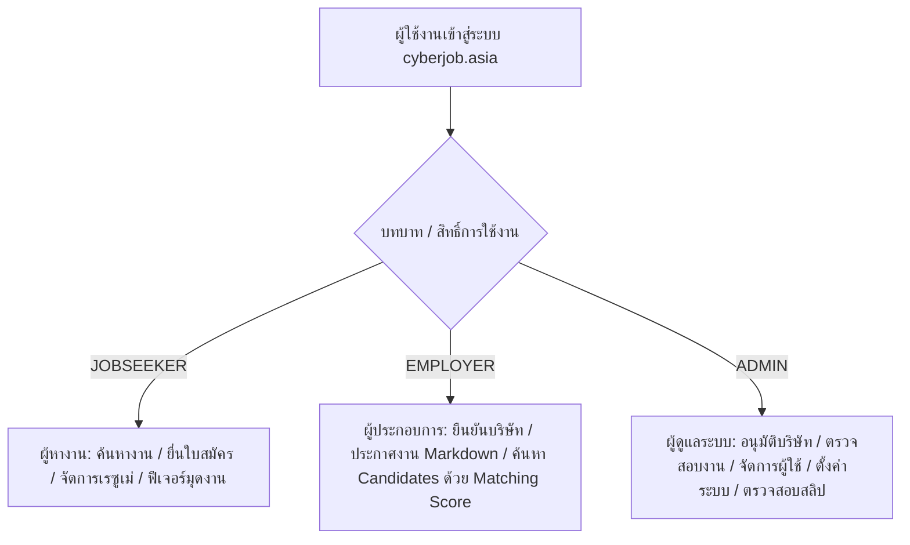

# คู่มือการใช้งานแพลตฟอร์ม CyberJob (CyberJob User & Administrator Manual)

> **เว็บไซต์:** [https://cyberjob.asia](https://cyberjob.asia)  
> **แพลตฟอร์ม:** แพลตฟอร์มหางานและคัดสรรบุคลากรเฉพาะทางด้านความมั่นคงปลอดภัยไซเบอร์ (Cybersecurity Job Platform) แห่งแรกของประเทศไทย  
> **เวอร์ชันเอกสาร:** 2.0 (ปรับปรุงล่าสุด: กันยายน 2026)

---

## สารบัญ

1. [บทนำและภาพรวมระบบ (Overview)](#1-บทนำและภาพรวมระบบ-overview)
2. [ระบบบัญชีผู้ใช้และความปลอดภัย (Authentication & Security)](#2-ระบบบัญชีผู้ใช้และความปลอดภัย-authentication--security)
   - 2.1 [การเข้าสู่ระบบด้วยอีเมลและรหัสผ่าน พร้อมยืนยัน OTP (Email & Password + OTP 2FA)](#21-การเข้าสู่ระบบด้วยอีเมลและรหัสผ่าน-พร้อมยืนยัน-otp)
   - 2.2 [การเข้าสู่ระบบผ่าน Google Account (Google Sign-In One-Tap)](#22-การเข้าสู่ระบบผ่าน-google-account)
   - 2.3 [การสมัครสมาชิกใหม่](#23-การสมัครสมาชิกใหม่)
   - 2.4 [การแยกสิทธิ์และการเปลี่ยนเส้นทางอัตโนมัติ (Role-based Routing)](#24-การแยกสิทธิ์และการเปลี่ยนเส้นทางอัตโนมัติ)
3. [คู่มือสำหรับผู้หางาน (Jobseeker / Member Manual)](#3-คู่มือสำหรับผู้หางาน-jobseeker--member-manual)
   - 3.1 [การค้นหาและกรองตำแหน่งงาน (Job Search & Filter)](#31-การค้นหาและกรองตำแหน่งงาน)
   - 3.2 [การดูรายละเอียดงานและการบันทึกงานที่สนใจ (Job Details & Bookmark)](#32-การดูรายละเอียดงานและการบันทึกงานที่สนใจ)
   - 3.3 [ขั้นตอนการสมัครงาน 3 ขั้นตอน (3-Step Application Process)](#33-ขั้นตอนการสมัครงาน-3-ขั้นตอน)
   - 3.4 [การจัดการโปรไฟล์และเรซูเม่ดิจิทัล (Digital Resume & Profile)](#34-การจัดการโปรไฟล์และเรซูเม่ดิจิทัล)
   - 3.5 [ระบบความเป็นส่วนตัว: ฟีเจอร์ "มุดงาน" (Hide Job) และ Always Allow](#35-ระบบความเป็นส่วนตัว-ฟีเจอร์-มุดงาน-hide-job-และ-always-allow)
   - 3.6 [การติดตามสถานะการสมัครงาน (My Applications)](#36-การติดตามสถานะการสมัครงาน)
   - 3.7 [การตอบรับคำเชิญจากบริษัท (Invitations)](#37-การตอบรับคำเชิญจากบริษัท)
   - 3.8 [คลังความรู้และบทความด้านความมั่นคงไซเบอร์ (Articles)](#38-คลังความรู้และบทความด้านความมั่นคงไซเบอร์)
4. [คู่มือสำหรับผู้ประกอบการ (Business Owner / Employer Manual)](#4-คู่มือสำหรับผู้ประกอบการ-business-owner--employer-manual)
   - 4.1 [หน้าแรกแดชบอร์ดและการสรุปผลสถิติ (Dashboard & Overview)](#41-หน้าแรกแดชบอร์ดและการสรุปผลสถิติ)
   - 4.2 [การยืนยันตัวตนบริษัทและเอกสารทางกฎหมาย (Company Verification)](#42-การยืนยันตัวตนบริษัทและเอกสารทางกฎหมาย)
   - 4.3 [การสร้างและจัดการประกาศงานด้วย Markdown Editor (Job Postings)](#43-การสร้างและจัดการประกาศงานด้วย-markdown-editor)
   - 4.4 [การตั้งค่าคำถามคัดกรองผู้สมัคร (Screening Questions)](#44-การตั้งค่าคำถามคัดกรองผู้สมัคร)
   - 4.5 [การค้นหาบุคลากรและคะแนนความเหมาะสม (Candidate Search & Matching Score)](#45-การค้นหาบุคลากรและคะแนนความเหมาะสม)
   - 4.6 [การคัดเลือกผู้สมัครและการส่งคำเชิญ (Applicant Review & Invitation)](#46-การคัดเลือกผู้สมัครและการส่งคำเชิญ)
   - 4.7 [การเลือกแพ็กเกจและการแจ้งชำระเงิน (Packages & Payments)](#47-การเลือกแพ็กเกจและการแจ้งชำระเงิน)
   - 4.8 [วิดีโอแนะนำการใช้งานและการตั้งค่าบริษัท (Tutorials & Settings)](#48-วิดีโอแนะนำการใช้งานและการตั้งค่าบริษัท)
5. [คู่มือสำหรับผู้ดูแลระบบ (Admin Manual)](#5-คู่มือสำหรับผู้ดูแลระบบ-admin-manual)
   - 5.1 [การเข้าสู่ระบบหลังบ้าน (Admin Portal Access)](#51-การเข้าสู่ระบบหลังบ้าน)
   - 5.2 [แดชบอร์ดสถิติรวมของระบบ (Admin Dashboard)](#52-แดชบอร์ดสถิติรวมของระบบ)
   - 5.3 [การตรวจสอบและอนุมัติบริษัท (Company Verification & Management)](#53-การตรวจสอบและอนุมัติบริษัท)
   - 5.4 [การกำกับดูแลประกาศงาน (Job Postings Moderation)](#54-การกำกับดูแลประกาศงาน)
   - 5.5 [การจัดการผู้ใช้งานและสิทธิ์ (User Management)](#55-การจัดการผู้ใช้งานและสิทธิ์)
   - 5.6 [การตรวจสอบการชำระเงินและแพ็กเกจ (Subscription & Slip Verification)](#56-การตรวจสอบการชำระเงินและแพ็กเกจ)
   - 5.7 [การจัดการพจนานุกรมทักษะไซเบอร์ (Synonym & Keyword Management)](#57-การจัดการพจนานุกรมทักษะไซเบอร์)
   - 5.8 [การตั้งค่าระบบและวิดีโอคู่มือ (System Settings & Video Tutorials)](#58-การตั้งค่าระบบและวิดีโอคู่มือ)
6. [คำถามที่พบบ่อยและการแก้ไขปัญหา (FAQs & Troubleshooting)](#6-คำถามที่พบบ่อยและการแก้ไขปัญหา-faqs--troubleshooting)
7. [ช่องทางการติดต่อและสนับสนุน (Contact & Support)](#7-ช่องทางการติดต่อและสนับสนุน-contact--support)

---

## 1. บทนำและภาพรวมระบบ (Overview)

**CyberJob** เป็นศูนย์กลางรวบรวมตำแหน่งงานด้าน **Cybersecurity & Information Security** ที่ออกแบบมาเพื่อตอบโจทย์ทั้งผู้ที่มีความเชี่ยวชาญด้านไซเบอร์และองค์กรที่ต้องการทีมงานมืออาชีพ โดยแบ่งบทบาทผู้ใช้งานออกเป็น 3 กลุ่มหลัก:

### จุดเด่นของแพลตฟอร์ม
- **Specialized for Cybersecurity:** มีหมวดหมู่งานและตัวกรองเฉพาะทาง เช่น SOC Analyst, Penetration Tester, Incident Responder, Cloud Security, Threat Hunter, GRC Specialist ฯลฯ
- **Two-Factor Authentication (OTP 2FA):** เสริมความปลอดภัยขั้นสูงด้วยรหัสยืนยันแบบใช้ครั้งเดียวผ่านอีเมล
- **Markdown Job Description & Real-time Preview:** ผู้ประกอบการสามารถเขียนรายละเอียดงานด้วย Markdown จัดรูปแบบหัวข้อ รายการ และเน้นข้อความได้สวยงามทันสมัย
- **Smart Candidate Matching:** ระบบคำนวณ Matching Score จับคู่ทักษะของผู้สมัครกับความต้องการของตำแหน่งงานโดยอัตโนมัติ
- **Privacy First (โหมดมุดงาน):** ผู้หางานสามารถซ่อนโปรไฟล์ของตนเองจากบริษัทปัจจุบันเพื่อความสบายใจในการหางานใหม่

---

## 2. ระบบบัญชีผู้ใช้และความปลอดภัย (Authentication & Security)

### 2.1 การเข้าสู่ระบบด้วยอีเมลและรหัสผ่าน พร้อมยืนยัน OTP
ระบบ CyberJob ใช้มาตรฐานความปลอดภัยระดับสูงสำหรับสมาชิกทั่วไปและผู้ประกอบการ:

1. เข้าไปที่หน้าเข้าสู่ระบบ: [https://cyberjob.asia/gate/login](https://cyberjob.asia/gate/login)
2. เลือกแท็บประเภทบัญชี: **ผู้หางาน** หรือ **ผู้ประกอบการ**
3. กรอก **อีเมล** และ **รหัสผ่าน** แล้วคลิก **"เข้าสู่ระบบ"**
4. หากข้อมูลถูกต้อง ระบบจะแสดงหน้าต่าง **"ยืนยันรหัส OTP (2-Factor Authentication)"**
5. ระบบส่งรหัสตัวเลข 6 หลักไปยังอีเมลที่ลงทะเบียนไว้ (รหัสมีอายุ **5 นาที**)
6. กรอกรหัส OTP 6 ช่อง (รองรับการ Copy และ Paste รหัส 6 หลักลงช่องแรกได้ทันที)
7. เมื่อรหัสถูกต้อง ระบบจะนำเข้าสู่แดชบอร์ดตามสิทธิ์ทันที
8. *หากไม่ได้รับรหัส:* สามารถกด **"ส่งรหัส OTP อีกครั้ง"** ได้เมื่อหมดเวลานับถอยหลัง 60 วินาที

> [!NOTE]
> บัญชีที่มีสิทธิ์ **ผู้ดูแลระบบ (ADMIN)** จะได้รับการยกเว้น OTP เพื่อความสะดวกรวดเร็วในการเข้าจัดการหลังบ้าน

---

### 2.2 การเข้าสู่ระบบผ่าน Google Account
แพลตฟอร์มรองรับ **Google Identity Services (GIS)** ทั้งแบบปุ่มคลิกและหน้าต่าง One-Tap:
1. ที่หน้า Login หรือ Register คลิกปุ่ม **"เข้าสู่ระบบด้วย Google"**
2. เลือกบัญชี Google ของท่าน
3. กดยืนยันสิทธิ์ ระบบจะทำการจับคู่อีเมล หรือสร้างบัญชีใหม่ตามแท็บบทบาทที่เลือกไว้
4. เข้าสู่ระบบได้ทันทีโดยไม่ต้องจำรหัสผ่าน

---

### 2.3 การสมัครสมาชิกใหม่
1. ไปที่ [https://cyberjob.asia/gate/register](https://cyberjob.asia/gate/register)
2. เลือกประเภทบัญชี:
   - **ผู้หางาน:** สำหรับบุคคลทั่วไป นักศึกษา หรือมืออาชีพที่กำลังมองหางาน
   - **ผู้ประกอบการ:** สำหรับบริษัท หรือตัวแทน HR ที่ต้องการลงประกาศงาน
3. กรอก **ชื่อ-นามสกุล, อีเมล, รหัสผ่าน (ความยาวไม่ต่ำกว่า 8 ตัวอักษร มีตัวเลขและอักขระพิเศษ)**
4. กดยอมรับเงื่อนไขการใช้งานและนโยบายความเป็นส่วนตัว
5. คลิก **"สร้างบัญชีผู้ใช้"**

---

### 2.4 การแยกสิทธิ์และการเปลี่ยนเส้นทางอัตโนมัติ
เมื่อผ่านการยืนยันตัวตน ระบบจะนำท่านไปยังหน้าที่ถูกต้องโดยอัตโนมัติ:
- **JOBSEEKER (ผู้หางาน):** นำไปยังหน้าแรก `https://cyberjob.asia/` หรือหน้างานที่กำลังเลือก
- **EMPLOYER (ผู้ประกอบการ):** นำไปยังแดชบอร์ดบริษัท `https://cyberjob.asia/dashboard`
- **ADMIN (ผู้ดูแลระบบ):** นำไปยังศูนย์ควบคุมหลังบ้าน `https://cyberjob.asia/admin`

---

## 3. คู่มือสำหรับผู้หางาน (Jobseeker / Member Manual)

### 3.1 การค้นหาและกรองตำแหน่งงาน
ผู้หางานสามารถค้นหางานด้าน Cybersecurity ได้อย่างแม่นยำผ่านหน้า [https://cyberjob.asia/jobs](https://cyberjob.asia/jobs):
- **ช่องค้นหาหลัก:** พิมพ์ชื่อตำแหน่ง เช่น *SOC Analyst, Pentester, DevSecOps* หรือชื่อบริษัท
- **ตัวกรองระดับประสบการณ์:** 
  - นักศึกษาจบใหม่ / ฝึกงาน (0 ปี)
  - ระดับเริ่มต้น (1–2 ปี)
  - ระดับกลาง (3–5 ปี)
  - ระดับอาวุโส (6–10 ปี หรือ 10+ ปี)
- **รูปแบบการทำงาน:** ทำงานที่ออฟฟิศ (On-site), ไฮบริด (Hybrid), หรือทำงานจากที่บ้าน (Remote 100%)
- **ประเภทการจ้างงาน:** งานประจำ (Full-time), สัญญาจ้าง (Contract), งานชั่วคราว (Part-time / Temp), งานฝึกงาน (Internship)
- **ช่วงเงินเดือน:** ปรับแถบเลื่อนตามช่วงเงินเดือนที่ต้องการ

---

### 3.2 การดูรายละเอียดงานและการบันทึกงานที่สนใจ
- คลิกที่การ์ดตำแหน่งงานเพื่อเปิดหน้ารายละเอียดเต็ม
- ตรวจสอบคุณสมบัติ, สวัสดิการ, ที่ตั้งบริษัท และคำถามคัดกรองเบื้องต้น
- กดปุ่ม **"ไอคอนรูปหัวใจ / บันทึกงาน"** เพื่อเก็บงานไว้พิจารณาภายหลังในเมนู **งานที่บันทึกไว้**

---

### 3.3 ขั้นตอนการสมัครงาน 3 ขั้นตอน (3-Step Application Process)
เมื่อพบงานที่ต้องการ คลิก **"สมัครงานนี้"** ระบบจะนำเข้าสู่ขั้นตอนการสมัครที่กระชับและเป็นมืออาชีพ:

1. **ขั้นตอนที่ 1: ข้อมูลผู้สมัครและเรซูเม่ (`/apply-step1`)**
   - ตรวจสอบชื่อ-นามสกุล, เบอร์ติดต่อ, อีเมล
   - เลือกใช้ **เรซูเม่จากระบบ CyberJob** หรือ **อัปโหลดไฟล์ PDF/DOCX ใหม่**
2. **ขั้นตอนที่ 2: ทักษะและความเชี่ยวชาญ (`/apply-step2`)**
   - ตรวจสอบรายการทักษะที่เกี่ยวข้องกับตำแหน่ง เช่น *Wireshark, Splunk, Python, ISO 27001*
   - ตอบคำถามคัดกรองเบื้องต้นที่ทางองค์กรกำหนดไว้ (ถ้ามี)
3. **ขั้นตอนที่ 3: ตรวจสอบและส่งใบสมัคร (`/apply-step3`)**
   - แนบ Portfolio, ใบ Certificate (เช่น CompTIA Security+, CEH, CISSP)
   - เขียนจดหมายแนะนำตัว (Cover Letter) สั้นๆ เพื่อเน้นจุดเด่น
   - กดยืนยัน **"ส่งใบสมัคร"**

---

### 3.4 การจัดการโปรไฟล์และเรซูเม่ดิจิทัล
เข้าเมนู [https://cyberjob.asia/profile](https://cyberjob.asia/profile) เพื่อสร้างความน่าสนใจให้โปรไฟล์:
- **ข้อมูลส่วนตัว:** รูปโปรไฟล์, ตำแหน่งปัจจุบัน, สรุปความเป็นมืออาชีพ (About Me)
- **ประวัติการศึกษา:** ระดับการศึกษา, มหาวิทยาลัย, สาขาวิชา, เกรดเฉลี่ย
- **ประสบการณ์การทำงาน:** ระบุตำแหน่ง, บริษัท, ระยะเวลาทำงาน, หน้าที่และผลงานสำคัญ
- **ใบรับรองคุณวุฒิ (Certifications):** อัปโหลดภาพหรือ PDF ใบรับรองด้านไซเบอร์ เพื่อเพิ่มความน่าเชื่อถือ
- **ทักษะทางเทคนิค:** กำหนดระดับความชำนาญ (Beginner, Intermediate, Advanced, Expert)
- **ดูตัวอย่างเรซูเม่ (Preview Resume):** คลิกเพื่อดูรูปแบบเรซูเม่มาตรฐานที่บริษัทจะมองเห็น สามารถดาวน์โหลดเก็บไว้ได้

---

### 3.5 ระบบความเป็นส่วนตัว: ฟีเจอร์ "มุดงาน" (Hide Job) และ Always Allow
CyberJob เข้าใจถึงความเป็นส่วนตัวของผู้ที่กำลังมองหางานใหม่ในขณะที่ยังมีงานประจำ:
- **ฟังก์ชัน "มุดงาน (Hide Job)":**
  - สามารถระบุชื่อบริษัทปัจจุบันของท่าน ระบบจะทำการ **ซ่อนโปรไฟล์ของท่านจากการค้นหาของบริษัทดังกล่าว 100%** HR ของบริษัทเดิมจะไม่สามารถค้นพบเรซูเม่ของท่านบนแพลตฟอร์มได้
- **ฟังก์ชัน "Always Allow Invitations":**
  - เปิดรับคำเชิญให้สมัครงานจากบริษัทชั้นนำ แม้ท่านจะไม่ได้เปิดสถานะหางานแบบสาธารณะก็ตาม

---

### 3.6 การติดตามสถานะการสมัครงาน (My Applications)
เข้าเมนู [https://cyberjob.asia/my-jobs](https://cyberjob.asia/my-jobs) เพื่อดูความคืบหน้าของทุกงานที่ส่งใบสมัคร:
- **ส่งใบสมัครแล้ว (Submitted):** บริษัทได้รับใบสมัครเรียบร้อยแล้ว
- **กำลังพิจารณา (Reviewing):** ฝ่ายบุคคลกำลังตรวจสอบคุณสมบัติ
- **นัดสัมภาษณ์ (Interview):** ได้รับเลือกเข้าสู่รอบสัมภาษณ์
- **ปฏิเสธ (Rejected):** ไม่ผ่านการคัดเลือกในรอบนี้
- **ผ่านการคัดเลือก (Hired):** ได้รับการเสนองาน

---

## 4. คู่มือสำหรับผู้ประกอบการ (Business Owner / Employer Manual)

### 4.1 หน้าแรกแดชบอร์ดและการสรุปผลสถิติ
เมื่อเข้าสู่ระบบในฐานะผู้ประกอบการ แดชบอร์ด [https://cyberjob.asia/dashboard](https://cyberjob.asia/dashboard) จะแสดง:
- จำนวนประกาศงานที่กำลังเปิดรับสมัคร (Active Jobs)
- จำนวนผู้สมัครงานทั้งหมดในรอบเดือน (Total Applicants)
- จำนวนคำเชิญที่ส่งไปและอัตราการตอบรับ (Invitations & Responses)
- กราฟสถิติผู้เข้าชมประกาศงานแบบรายวันและรายสัปดาห์
- การแจ้งเตือนใบสมัครใหม่ที่ต้องตรวจสอบ

---

### 4.2 การยืนยันตัวตนบริษัทและเอกสารทางกฎหมาย
เพื่อสร้างความน่าเชื่อถือและป้องกันมิจฉาชีพ องค์กรต้องผ่านการยืนยันตัวตนที่เมนู [https://cyberjob.asia/company](https://cyberjob.asia/company):
1. กรอกข้อมูลบริษัท: ชื่อทางการค้า, เลขประจำตัวผู้เสียภาษี 13 หลัก, ที่อยู่สำนักงาน, เว็บไซต์
2. แนบเอกสารหลักฐานสำคัญ (PDF หรือ รูปภาพชัดเจน):
   - **หนังสือรับรองนิติบุคคล (อายุไม่เกิน 6 เดือน)**
   - **สำเนาบัตรประชาชนกรรมการผู้มีอำนาจลงนาม**
   - **ภาพถ่ายสำนักงานจริงพร้อมป้ายชื่อบริษัท**
   - **เอกสาร ภ.พ.20 (ถ้ามี)**
3. คลิก **"ส่งเอกสารเพื่อขอรับการยืนยัน"**
4. ทีมงาน CyberJob จะตรวจสอบและอนุมัติภายใน 1–3 วันทำการ เมื่อผ่านแล้วจะได้รับตราสัญลักษณ์ **"Verified Employer"** สีฟ้า

---

### 4.3 การสร้างและจัดการประกาศงานด้วย Markdown Editor
สร้างตำแหน่งงานใหม่ที่เมนู [https://cyberjob.asia/job-postings/create](https://cyberjob.asia/job-postings/create):
- **หัวข้อตำแหน่งงาน:** ระบุให้ชัดเจน เช่น *Senior Penetration Tester, Information Security Officer*
- **หมวดหมู่งานและระดับประสบการณ์:** เลือกหมวดหมู่ที่ตรงตามมาตรฐานสากล
- **รูปแบบการทำงาน:** On-site / Hybrid / Remote
- **ค่าตอบแทน (เงินเดือน):**
  - ระบุช่วงเงินเดือนต่ำสุด - สูงสุด
  - หรือติ๊กเลือก **"งานฝึกงาน / ไม่ระบุเงินเดือน (Negotiable / Unpaid / Internship)"** กรณีเป็นงานโครงการสหกิจหรืองานฝึกงาน
- **รายละเอียดงานแบบ Markdown (Markdown Editor):**
  - รองรับการจัดฟอร์แมตข้อความ เช่น `#`, `##` สำหรับหัวข้อ, `-` สำหรับ Bullet list, `**ตัวหนา**`
  - มีปุ่มเครื่องมือช่วยใส่สัญลักษณ์อัตโนมัติ
  - **หน้าจอ Preview แยกฝั่ง:** แสดงผลจริงทางขวามือทันที ช่วยให้เห็นว่าผู้หางานจะเห็นประกาศงานอย่างไร
- **สถานะการบันทึก:** สามารถเลือก **"บันทึกแบบร่าง (Draft)"** เพื่อแก้ไขต่อ หรือกด **"เผยแพร่ทันที (Publish)"**

---

### 4.4 การตั้งค่าคำถามคัดกรองผู้สมัคร (Screening Questions)
ผู้ประกอบการสามารถเพิ่มคำถามคัดกรองล่วงหน้าตอนลงประกาศงาน:
- คำถามแบบตัวเลือก (Single Choice / Yes-No) เช่น *"มีใบรับรอง Security+ หรือไม่?"*
- คำถามแบบพิมพ์ข้อความสั้น/ยาว เช่น *"เคยมีประสบการณ์ใช้ EDR ยี่ห้อใดบ้าง?"*
- คำถามระบุวันพร้อมเริ่มงาน

---

### 4.5 การค้นหาบุคลากรและคะแนนความเหมาะสม (Matching Score)
ไปที่เมนู [https://cyberjob.asia/candidates](https://cyberjob.asia/candidates):
- ค้นหาเรซูเม่ตามคีย์เวิร์ด, ทักษะเฉพาะทาง (เช่น *Reverse Engineering, SOC Tier 2*), ประสบการณ์
- **ระบบ Matching Score:**
  - แสดงคะแนนเป็นเปอร์เซ็นต์ (เช่น 92% Match) คำนวณจากทักษะในโปรไฟล์เทียบกับตำแหน่งที่เปิดรับ
  - คลิกดูเหตุผลประกอบว่าทำไมคะแนนถึงสูง (ทักษะตรงกี่ข้อ, ประสบการณ์ตรงสายงานหรือไม่)

---

### 4.6 การคัดเลือกผู้สมัครและการส่งคำเชิญ
- เมื่อพบผู้สมัครที่ตรงใจ สามารถคลิก **"ส่งคำเชิญสมัครงาน (Invite Candidate)"** ไปยังผู้หางานโดยตรง
- ติดตามการตอบรับในแท็บ **คำเชิญ (Invitations)**: ตอบรับแล้ว / รอการตอบกลับ / สละสิทธิ์
- ในหน้าใบสมัครที่ส่งเข้ามา สามารถเปลี่ยนสถานะผู้สมัคร (เรียกสัมภาษณ์ / ไม่ผ่านเกณฑ์ / ผ่านการคัดเลือก)

---

### 4.7 การเลือกแพ็กเกจและการแจ้งชำระเงิน
เข้าเมนู [https://cyberjob.asia/packages](https://cyberjob.asia/packages) เพื่ออัปเกรดความสามารถ:
- **Starter (Free):** ลงประกาศงานพื้นฐาน 1 ตำแหน่ง
- **Gold:** ลงประกาศงานได้เพิ่มขึ้น ดูประวัติผู้สมัครได้ไม่จำกัดจำนวน
- **Platinum:** ติดป้ายประกาศงานเด่น (Featured Job), ส่งคำเชิญผู้สมัครได้ไม่จำกัด, ได้รับการแสดงผลลำดับแรก
- **วิธีการชำระเงิน:**
  - สแกน QR Code ผ่าน PromptPay หรือโอนเข้าบัญชีธนาคารของบริษัท
  - แนบหลักฐานสลิปการโอนเงินและระบุเวลาในฟอร์ม
  - ระบบจะส่งเรื่องให้ Admin อนุมัติแพ็กเกจให้อย่างรวดเร็ว

---

## 5. คู่มือสำหรับผู้ดูแลระบบ (Admin Manual)

### 5.1 การเข้าสู่ระบบหลังบ้าน
1. เข้าผ่าน URL เฉพาะ: [https://cyberjob.asia/admin](https://cyberjob.asia/admin)  
   *(หรือล็อกอินจากหน้า `/gate/login` ด้วยบัญชีที่มีสิทธิ์ `ADMIN` ระบบจะพาเข้ามาหน้านี้โดยตรง)*
2. กรอกอีเมลและรหัสผ่านของผู้ดูแลระบบ (สิทธิ์ Admin จะผ่านเข้าสู่ระบบทันทีโดยไม่ต้องใช้ OTP)
3. ระบบจะแสดงหน้าจอ **Admin Dashboard** สี Navy-Dark ที่ได้มาตรฐาน

---

### 5.2 แดชบอร์ดสถิติรวมของระบบ
หน้ารวมสถิติระบบ [https://cyberjob.asia/admin](https://cyberjob.asia/admin):
- จำนวนสมาชิกผู้หางานทั้งหมด (Jobseekers)
- จำนวนบริษัทที่ลงทะเบียน (Employers)
- จำนวนบริษัทที่รอการตรวจสอบเอกสาร (Pending Verifications)
- จำนวนตำแหน่งงานที่เปิดรับอยู่ในระบบ (Active Job Postings)
- ยอดการชำระเงินค่าแพ็กเกจที่รอการอนุมัติ

---

### 5.3 การตรวจสอบและอนุมัติบริษัท
เมนู [https://cyberjob.asia/admin/companies](https://cyberjob.asia/admin/companies):
- แสดงรายการบริษัทที่มีสถานะ `PENDING` (รออนุมัติ)
- คลิกเข้าไปดูรายละเอียดบริษัทและ **เปิดดูไฟล์เอกสารแนบ** (หนังสือรับรอง, บัตร ปชช. กรรมการ, รูปออฟฟิศ)
- การดำเนินการ:
  - **อนุมัติ (Approve):** บริษัทจะได้รับสถานะ Verified และสามารถลงประกาศงานได้ทันที
  - **ปฏิเสธ (Reject):** ระบุเหตุผล เช่น เอกสารไม่ชัดเจน, หนังสือรับรองหมดอายุ เพื่อแจ้งให้บริษัทแก้ไข
  - **ระงับการใช้งาน (Suspend):** ปิดกั้นบริษัทที่ไม่ปฏิบัติตามกฎ

---

### 5.4 การกำกับดูแลประกาศงาน
เมนู [https://cyberjob.asia/admin/jobs](https://cyberjob.asia/admin/jobs):
- ตรวจสอบความถูกต้องของประกาศงานในระบบ
- สามารถค้นหาตามชื่อตำแหน่ง, บริษัท, หรือหมวดหมู่
- สามารถสั่ง **ซ่อนงาน (Hide)**, **แก้ไขหมวดหมู่**, หรือ **ลบประกาศงาน (Delete)** ที่ผิดนโยบาย

---

### 5.5 การจัดการผู้ใช้งานและสิทธิ์
เมนู [https://cyberjob.asia/admin/users](https://cyberjob.asia/admin/users):
- แสดงรายชื่อผู้ใช้งานทั้งหมด พร้อมระบุ Role (`JOBSEEKER`, `EMPLOYER`, `ADMIN`) และ Provider (`LOCAL`, `GOOGLE`)
- ค้นหาผู้ใช้ด้วยชื่อหรืออีเมล
- ความสามารถของผู้ดูแล:
  - เปลี่ยนบทบาทผู้ใช้งาน (Change Role)
  - รีเซ็ตรหัสผ่านชั่วคราว
  - สั่งระงับบัญชีผู้ใช้ (Suspend / Ban) กรณีทำผิดกฎหมาย

---

### 5.6 การตรวจสอบการชำระเงินและแพ็กเกจ
เมนู [https://cyberjob.asia/admin/packages](https://cyberjob.asia/admin/packages):
- ตรวจสอบรายการแจ้งโอนเงินค่าแพ็กเกจจากผู้ประกอบการ
- ตรวจดูรูปภาพสลิป ยอดเงิน วันที่ และเวลาโอน
- คลิก **"อนุมัติสลิป"** ระบบจะปรับระดับแพ็กเกจของบริษัทเป็น `GOLD` หรือ `PLATINUM` พร้อมกำหนดวันหมดอายุให้อัตโนมัติ

---

### 5.7 การจัดการพจนานุกรมทักษะไซเบอร์ (Synonym & Keyword Management)
เมนู [https://cyberjob.asia/admin/synonyms](https://cyberjob.asia/admin/synonyms):
- ระบบช่วยให้การจับคู่งานแม่นยำขึ้น โดยแปลงคำศัพท์ที่มีความหมายเหมือนกันให้อยู่ในกลุ่มเดียวกัน เช่น:
  - คำหลัก: `Penetration Testing`  
    คำเหมือน (Synonyms): `Pentest`, `Ethical Hacking`, `VAPT`, `ทดสอบเจาะระบบ`
  - คำหลัก: `SOC Analyst`  
    คำเหมือน: `Security Operations Center`, `Cyber Threat Monitoring`, `Tier 1 SOC`
- Admin สามารถเพิ่ม ลบ หรือแก้ไขกลุ่มคำเหล่านี้เพื่อให้ระบบ Matching Score ทำงานได้ฉลาดขึ้นอย่างต่อเนื่อง

---

### 5.8 การตั้งค่าระบบและวิดีโอคู่มือ
เมนู [https://cyberjob.asia/admin/settings](https://cyberjob.asia/admin/settings):
- จัดการข้อมูลติดต่อของระบบ, ลิงก์ LINE OA, เบอร์โทรศัพท์ และอีเมลฝ่ายบริการ
- **การจัดการลิงก์วิดีโอ YouTube:** สามารถนำลิงก์ YouTube วิดีโอสอนการใช้งานมาใส่ในหัวข้อ Tutorial 1–5 เพื่อให้ไปแสดงผลบนหน้าเว็บของผู้ประกอบการทันที

---

## 6. คำถามที่พบบ่อยและการแก้ไขปัญหา (FAQs & Troubleshooting)

### Q1: ไม่ได้รับรหัส OTP ทางอีเมล ต้องทำอย่างไร?
- **ตอบ:** 
  1. ตรวจสอบในโฟลเดอร์ **Junk Mail / จดหมายขยะ (Spam)**
  2. ตรวจสอบว่าอีเมลที่กรอกสะกดถูกต้องหรือไม่
  3. รอครบกำหนดเวลานับถอยหลัง 60 วินาที แล้วกดปุ่ม **"ส่งรหัส OTP อีกครั้ง"**

### Q2: ลืมรหัสผ่าน เข้าสู่ระบบไม่ได้?
- **ตอบ:** 
  - หากเคยสมัครผ่าน Google Account สามารถกดปุ่ม **"เข้าสู่ระบบด้วย Google"** เพื่อเข้าใช้งานได้ทันที
  - หากใช้อีเมลปกติ สามารถกดที่ลิงก์ **"ลืมรหัสผ่าน?"** เพื่อรับลิงก์รีเซ็ตรหัสผ่านทางอีเมล หรือติดต่อผู้ดูแลระบบ

### Q3: ลงประกาศงานแล้ว แต่ไม่แสดงในหน้ารวมงาน?
- **ตอบ:** 
  1. ตรวจสอบสถานะประกาศงานว่าเป็น **"เผยแพร่แล้ว (Published)"** หรือยังค้างอยู่ที่ **"แบบร่าง (Draft)"**
  2. ตรวจสอบสถานะการยืนยันตัวตนของบริษัท (ต้องได้รับการอนุมัติเอกสารจาก Admin ก่อน ประกาศงานจึงจะแสดงต่อสาธารณะ)

### Q4: หน้าจอแสดงผลไม่ถูกต้อง หรือกดบางปุ่มไม่ทำงาน?
- **ตอบ:** 
  - ลองกด **Ctrl + F5** (หรือ Command + Shift + R บน Mac) เพื่อล้างแคชของเบราว์เซอร์
  - แพลตฟอร์มรองรับได้ดีที่สุดบน Google Chrome, Microsoft Edge, Safari และ Firefox เวอร์ชันล่าสุด

---

## 7. ช่องทางการติดต่อและสนับสนุน (Contact & Support)

หากท่านพบปัญหาการใช้งาน มีข้อสงสัยทางเทคนิค หรือต้องการความช่วยเหลือเพิ่มเติม สามารถติดต่อทีมงาน CyberJob ได้ตามช่องทางต่อไปนี้:

* **เว็บไซต์ทางการ:** [https://cyberjob.asia](https://cyberjob.asia)
* **หน้าติดต่อเราบนเว็บไซต์:** [https://cyberjob.asia/contact](https://cyberjob.asia/contact)
* **LINE Official Account:** [@cyberjob](https://lin.ee/qYT9XuK)
* **อีเมลฝ่ายบริการลูกค้า:** `support@cyberjob.asia` หรือ `contact@cyberjob.co.th`
* **เวลาทำการ:** วันจันทร์ – วันศุกร์ เวลา 09:00 – 18:00 น. (เว้นวันหยุดนักขัตฤกษ์)

---
*เอกสารนี้จัดทำขึ้นสำหรับแพลตฟอร์ม CyberJob ลิขสิทธิ์ถูกต้องตามกฎหมาย พ.ศ. 2569*
